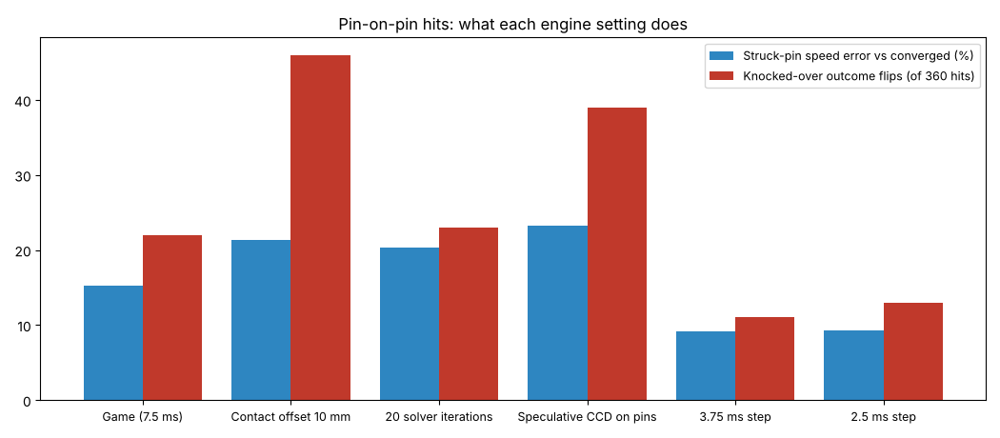
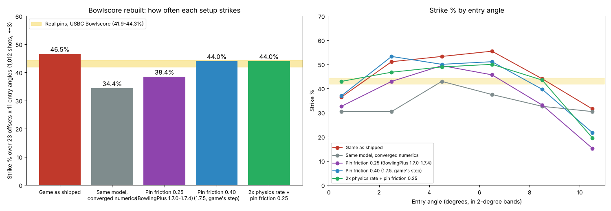

# Pin physics study (BowlingPlus 1.7.0, corrected in 1.7.5)

What the game's pin physics really is, how it compares with real pins, what BowlingPlus can change, and whether upgrading Unity would help. Every number here comes from the game's own files (1.907) and from simulations in `tools/dev/pinlab`, which anyone can rerun.

> **Correction (1.7.5).** The first version of this study (1.7.0-1.7.4) combined the physics materials the wrong way. Unity's `PhysicsMaterialCombine` value 1, which every one of the game's materials uses, is **Multiply**, not Minimum (the game's own metadata: Average 0, Multiply 1, Minimum 2, Maximum 3). With Multiply, two pins rubbing together have friction 0.5 x 0.5 = 0.25 and bounce 0.65 x 0.65 = 0.42, not 0.5 and 0.65. Everything below was run again with each material's real combine mode. The main result changed: the game's pins already strike about as often as real pins on Bowlscore (46.5 % against 41.9-44.3 %), not 25 %. The old numbers, and why they were wrong, are in `Port/pin-physics/results/CORRECTION.md`.

## Short answers

- **Are the game's pins realistic?** On the one real-pin measure we have, close. On the US Bowling Congress's Bowlscore grid the game strikes **46.5 %** (±3.1) of the time; real pins strike **41.9-44.3 %**. The same model with converged numerics (a 0.5 ms step) strikes 34.4 %, so the game's coarse 7.5 ms step adds strikes.
- **What does BowlingPlus's "Realistic pin physics" do now?** It sets the pins' friction so the model lands inside the real range: **0.40** at the game's physics rate (44.0 %), or **0.25** with the double physics rate (also 44.0 %). 1.7.0-1.7.4 used 0.25 at the game's rate, which comes out at 38.4 %: fewer strikes than real pins.
- **Can the numerics be improved?** Yes: a smaller physics step. At 3.75 ms the ball-into-pin and pin-into-pin errors roughly halve. Larger contact offsets, more solver iterations and speculative collisions don't help.
- **Can Unity be upgraded without the source?** Not in practice. The engine is welded to the game's compiled code (IL2CPP) and to its data files; on iPhone both are one binary.
- **Would it be worth it?** No. The game is already on Unity 6 (6000.0.67f1), and Unity's built-in 3D physics is PhysX 4.1 in every version up to the 6.7 alpha.

## What the game actually does (read from its files)

The pins on the lane are `PinsPhys/PinUnity1..10` (`InventaryData.kegels`), not the `PinHolder` pins the old "Pin physics fix" changed (those never move; the lane doesn't use them). Each pin:

| | Value |
|---|---|
| Mass | 1.644 kg (3.62 lb; regulation 3.375-3.66 lb) |
| Centre of mass | 0.1498 m up the axis (`RunPsycsTest.pinCenterMass`) |
| Inertia | 0.013934 (tipping), 0.001915 (spin) kg m² (`pinInertiaTensor`) |
| Colliders | five convex hulls + a 6.1 cm capsule at the belly + a 3.2 cm sphere at the head; 0.379 m tall, belly radius 0.060 m (regulation 0.381 m, 0.0605 m) |
| Materials | "Pin": friction 0.5 sliding / 0.3 starting, bounce 0.65; "PinButtom" (base): bounce 0.4; combine mode **Multiply** |
| Collision | Discrete |
| At every rack | `InventaryData.ResetRigidBody` destroys the pin's Rigidbody and adds a new one, with max depenetration and max angular velocity 100000 (so no 7 rad/s spin cap) |

The rack is a regulation 12-inch triangle (head pin at y 18.263 m). The ball: radius 0.108 m, "Ball" material (0.3 / 0.3, bounce 0.65). Deck: friction 0.6 sliding / 0.9 starting, bounce 0.7. Kickbacks: friction 0.01, bounce 0.9 (combine Maximum). Physics: 7.5 ms step, 7/7 solver iterations, contact offset 0.5 mm, PGS solver, patch friction. All these materials are Multiply (the cushions' and pit floor's bounce is Minimum, the kickbacks' Maximum), so what touches what:

| Contact | Friction (sliding / starting) | Bounce |
|---|---|---|
| Pin on pin | 0.25 / 0.09 | 0.42 |
| Pin on deck | 0.30 / 0.27 | 0.46 (base 0.28) |
| Pin on ball | 0.15 / 0.09 | 0.42 |
| Ball on lane | set by the game every step from the oil (`BallSoundManager.OnCollisionStay`) | 0.42 |

**What BowlingPlus can change while the game runs** (both platforms; everything else was stripped from the engine binary too, not just from the scripts): per body mass, centre of mass, inertia, damping, velocities, collision mode, max angular and depenetration velocity; any physics material's friction (not bounciness). Not reachable through Unity: the physics step, solver iterations, contact offset, bounciness, combine modes. The step can be changed by writing the engine's own setting (the double physics rate, 1.7.1). A pin friction set by BowlingPlus is the pin material's value, so it's multiplied too: 0.40 means pin on pin 0.16, pin on deck 0.24 / 0.36, pin on ball 0.12.

## How it was tested

`tools/dev/pinlab` rebuilds the lane on NVIDIA PhysX 4.1 (built from NVIDIA's source, the engine Unity 6 embeds) with the game's exact pins, materials and their combine modes, deck, lane, gutters, kickbacks, pit, rack and settings, the way Unity drives PhysX (PGS, patch friction, persistent contacts). Left alone, a full rack stays put to 0.03 mm. Every setup is compared with the same model run at a 0.5 ms step and 20 solver iterations ("converged"), and the full-rack results with real pins (USBC Bowlscore). All runs: 11 October 2026.

## Results

**1. Ball into one pin** (17/20/23 mph, 12 and 15 lb, every 2 cm across the pin). With the game's 7.5 ms step the ball is 25 mm inside the pin on average (up to 50 mm) before the hit is resolved; the pin's launch speed is off by 10 % on average (up to 48 %) and its direction by 7.8°. The converged model gives 9.9 m/s for a head-on 20 mph hit with a 15 lb ball (rigid-impact theory: about 10.3 m/s).

**2. Pin into pin** (sliding, flying broadside, flying head-first, tumbling; 1.5-7 m/s; spin 0/20/45 rad/s; every offset). Nothing passes through anything, and no energy is created. About 1 hit in 16 ends differently from the converged model (a pin falls that shouldn't, or the other way round).



| Change | Struck-pin speed error | Outcome flips (of 360) | Ball-pin speed / angle error |
|---|---|---|---|
| Game (7.5 ms step) | 15 % | 22 | 10 % / 7.8° |
| Contact offset 5-10 mm | 19-21 % | 41-46 | 12 % / 5.3-7.2° |
| 20 solver iterations | 20 % | 23 | 9 % / 7.5° |
| 3.75 ms step | 9 % | 11 | 4.9 % / 4.3° |
| 2.5 ms step | 9 % | 13 | 4.2 % / 3.8° |
| Speculative collisions on pins | 23 % | 39 | |

Only a smaller step helps; speculative collisions are harmful (removed in 1.7.0).

**3. Full racks** (300 pocket throws, randomized speed, angle, pocket, revs and pin turns). The game strikes 38.7 %, the converged model 33.3 %; both leave the 10 pin most often (71 and 110 times). Individual throws rarely match: bowling is chaotic, so only distributions can be compared.

**4. Bowlscore, rebuilt.** USBC rolls balls into real pins at 23 offsets (0-5.5 in) and 11 entry angles (0-10°): 41.9-44.3 % strikes over the grid, and ball restitution barely matters (about 2.5 points across the whole COR range). The same grid in the model (1,012 shots per setup, ±3 points at 95 %):



| Setup | Strikes | 0-3° | 6-10° |
|---|---|---|---|
| **Game as shipped** | **46.5 %** | 43.8 % | 46.1 % |
| Converged model | 34.4 % | 30.4 % | 34.1 % |
| Pin friction 0.20 (game's step) | 35.6 % | 36.4 % | 30.4 % |
| Pin friction 0.25 (game's step; BowlingPlus 1.7.0-1.7.4) | 38.4 % | 37.8 % | 34.6 % |
| Pin friction 0.30 (game's step) | 39.5 % | 38.6 % | 36.1 % |
| Pin friction 0.35 (game's step) | 42.5 % | 44.3 % | 37.2 % |
| **Pin friction 0.40 (game's step; BowlingPlus 1.7.5)** | **44.0 %** | 45.1 % | 40.7 % |
| Pin friction 0.45 (game's step) | 45.0 % | 42.9 % | 43.3 % |
| 2x physics rate, game's friction | 50.0 % | 51.9 % | 45.4 % |
| **2x physics rate, pin friction 0.25 (BowlingPlus 1.7.1-1.7.5)** | **44.0 %** | 44.8 % | 41.3 % |
| 2x physics rate, pin friction 0.30 | 44.2 % | 44.0 % | 42.0 % |
| 2x physics rate, pin friction 0.40 | 48.7 % | 52.4 % | 42.2 % |
| 2x physics rate, pin restitution 0.75 | 55.9 % | 53.3 % | 54.8 % |
| 2x physics rate, deck friction 0.30 | 55.9 % | 57.6 % | 52.6 % |

- The game's own pins are already near real pins on this measure, a little high. Its coarse step is why: the same pins with converged numerics strike 34 %.
- Lower pin friction means fewer strikes (pins slide off each other instead of driving through). A smaller step means more strikes. 0.40 at the game's step and 0.25 at the double rate both land at 44 %, inside the real range.
- In every setup, strikes peak at 4-7° of entry angle and fall off at 8-10° (see the chart). The 0-3° vs 6-10° columns therefore don't separate the setups much; USBC published only the grid-wide range, so the model can't be checked per angle.
- Unlike the first version of this study, restitution does matter here (0.75 adds about 6 points), but it can't be set while the game runs.

## What BowlingPlus does (1.7.5)

- **Realistic pin physics** (Pin physics menu, Practice only): every lane pin collider gets the recommended friction, **0.40**, or **0.25** with Double physics rate (adjustable 0.10-0.50; Reset and turning it on set the recommended value, which then follows the Double physics rate switch), and the ball uses continuous collision. Off, outside Practice, or on a new scene, the pins get their own values back. Players who had 0.25 from 1.7.0-1.7.4 move to the recommended value; any other value they chose is kept.
- **Double physics rate (1.7.1, experimental)**: the engine's fixed step halved to 3.75 ms, with a speed check on every throw that undoes it if physics runs at the wrong speed.
- **Counts**: first balls (from a full rack) with it on and with it off: strikes, average pins and single-pin leaves, in the menu and in Copy debug info. Those are the real check: the model isn't real pins.

## Limits

- The model is the game's own physics, not real pins; it's compared with real pins only through Bowlscore's grid-wide strike rate, and its ball is a straight-rolling ramp ball.
- Whether a change *feels* right can only be judged on the phones; the counts in the menu are there for that.
- The physics step (the main numerical error) stays as the game has it unless the double rate is on.

## Rerunning it

```
tools/dev/pinlab/build_physx.sh                    # PhysX 4.1 from GitHub + pinlab (about 3 minutes)
cd tools/dev/pinlab
./pinlab rest scene.txt stock ref dt375            # a rack left alone
./pinlab ballpin scene.txt stock co5 co10 it20 dt375 dt25 ref > ballpin.csv
./pinlab pinpin scene.txt stock co5 co10 it20 dt375 dt25 spec ref > pinpin.csv
PINLAB_N=300 ./pinlab rack scene.txt stock stock_pf04 dt375_pf025 ref > rack.csv
PINLAB_SHOTS=4 ./pinlab bowlscore scene.txt stock > bowlscore_stock.csv   # one setup per file: stock_pf04, dt375_pf025, ref...
python3 export_scene.py <the game's Data folder> scene.txt   # re-export the scene from the game's files
```

`Port/pin-physics/results/` has every CSV used here, `summarize_bowlscore.py` (the Bowlscore table) and `make_charts.py` (the two charts).
